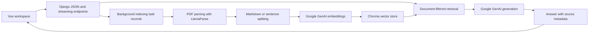

# AI Paper RAG

A local workspace for asking questions about selected research papers. It indexes uploaded PDFs, narrows retrieval to selected documents and attaches source snippets so readers can check an answer against the text.

## Architecture



- **Vue and Vite** provide the chat, document picker and workspace settings UI.
- **Django** exposes upload, document, status, task and question endpoints. SQLite stores task records.
- **LlamaParse and LlamaIndex** handle parsing, chunking and retrieval. Chroma persists vector entries. A Google GenAI model generates answers from retrieved context.
- The workspace supports single-paper summaries, comparison and question answering. The response serializer carries source snippets and document metadata. Citations should be checked against the original documents.

## Repository layout

| Path | Role |
| --- | --- |
| `ai_paper_rag_backend/chat_api/` | HTTP views, task records and migrations |
| `ai_paper_rag_backend/chat_api/services/rag_service.py` | Ingestion, retrieval, generation and citation assembly |
| `ai_paper_rag_backend/rag_core/` | Standalone ingestion and index helpers |
| `ai_paper_rag_frontend/src/` | Workspace components and API client logic |

## Local setup

Use Python 3.11 and Node.js 22. From the backend directory:

```powershell
python -m pip install -r requirements.txt
Copy-Item .env.example .env
# Set DJANGO_SECRET_KEY. Add GOOGLE_API_KEY and LLAMA_PARSE_API_KEY for provider calls.
python manage.py migrate
python manage.py runserver 127.0.0.1:8000
```

From `ai_paper_rag_frontend/`, run `npm ci`, then `npm run dev` and open port 5173. Upload a PDF you can share with the configured parsing and model services. Wait for the index job to complete, select the document and inspect citations after asking a question.

The migrated source omitted the Django settings module. This copy adds a local SQLite and environment-based configuration. The settings and document endpoints serve a single-user local workspace. Keep it on loopback unless access control and deployment configuration are added.


## Verification

The Vite production build and Django system check passed. All 12 Django tests passed using a clean SQLite test database and mocked provider calls. The complete Python dependency set installed on Python 3.11, and the 12 tests passed again with those dependencies. From the backend, rerun the local suite with `python manage.py test chat_api`. Real PDF ingestion and provider-backed retrieval require configured service keys and have not been exercised here.
